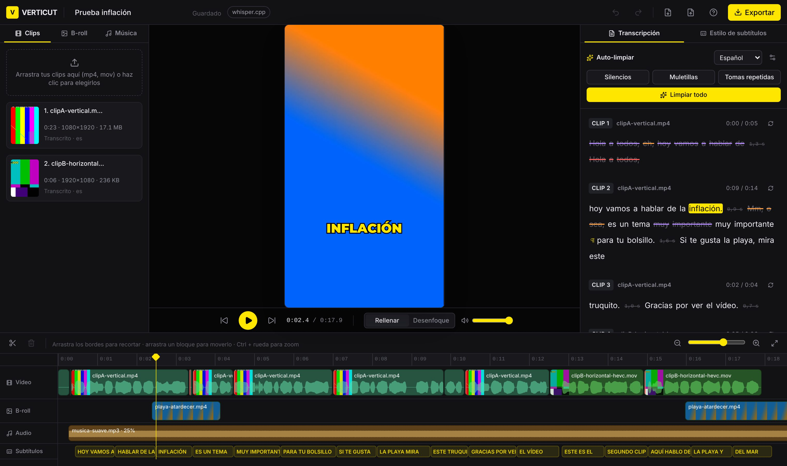

# Verticut

Editor web de vídeos verticales **9:16** a partir de clips en bruto, con **edición basada en transcripción**: borras palabras del texto y se cortan del vídeo.

Next.js 16 + TypeScript + Tailwind 4 · FFmpeg en el servidor · transcripción con la API de Whisper (OpenAI) o con whisper.cpp en local.



## Qué hace

| Función                  | Detalle                                                                                                                                                                                                                               |
| ------------------------ | ------------------------------------------------------------------------------------------------------------------------------------------------------------------------------------------------------------------------------------- |
| Subida múltiple          | Arrastra varios mp4/mov a la vez. Cada clip aparece con miniatura, duración y estado, y se coloca en orden en la línea de tiempo.                                                                                                     |
| Transcripción automática | Marcas de tiempo por palabra. Whisper API si hay `OPENAI_API_KEY`; si no, whisper.cpp local. Idioma por defecto: español.                                                                                                             |
| Edición por texto        | Selecciona palabras (arrastrar o Shift+clic) y pulsa **Supr**: el corte se aplica al vídeo, a la línea de tiempo y a los subtítulos. Las palabras cortadas se ven tachadas y se pueden restaurar. Doble clic corrige el texto.        |
| Auto-limpiar             | **Silencios** de más de 0,4 s (analizando el audio y los huecos de la transcripción), **muletillas** (eh, mm, o sea… lista editable) y **tomas repetidas**, quedándose con la última toma de cada frase.                              |
| Subtítulos TikTok        | Palabra a palabra, texto blanco con la palabra activa en amarillo `#FFE600`, fuente bold, abajo y centrado. Fuente, colores, tamaño, contorno, sombra, posición, palabras por bloque y mayúsculas configurables, con estilos rápidos. |
| Vista previa 9:16        | Reproduce la secuencia editada saltando los cortes. Clic en una palabra = salta a ese punto; la palabra que suena se resalta en la transcripción. Modo «Rellenar» o «Desenfoque» para clips horizontales.                             |
| Línea de tiempo          | Pistas de vídeo principal, B-roll, audio/música y subtítulos. Mover, recortar (bordes) y dividir (S) clips; zoom con Ctrl+rueda.                                                                                                      |
| B-roll                   | Carpeta de recursos (`recursos/`) con clips e imágenes que se arrastran a la pista. Sugerencias automáticas según las palabras clave de cada frase.                                                                                   |
| Exportar                 | MP4 H.264 1080×1920 a 30 fps con los subtítulos incrustados (FFmpeg + libass), con barra de progreso y cancelación.                                                                                                                   |
| Proyecto                 | Autoguardado en JSON (clips, cortes, B-roll, música y estilo de subtítulos). Descarga e importación del JSON. Deshacer/rehacer.                                                                                                       |

## Requisitos

- **Node.js 20** o superior.
- **FFmpeg 6 o superior** con `libx264` y `libass` (los paquetes habituales los incluyen):
  - macOS: `brew install ffmpeg`
  - Windows: `winget install Gyan.FFmpeg`
  - Ubuntu/Debian: `sudo apt install ffmpeg`
- Para transcribir, una de estas dos opciones:
  - una clave de la API de OpenAI, o
  - [whisper.cpp](https://github.com/ggml-org/whisper.cpp) compilado y un modelo `ggml`.

Comprueba FFmpeg con `ffmpeg -version`. Si no está en el `PATH`, indica su ruta en `FFMPEG_PATH` y `FFPROBE_PATH`.

## Puesta en marcha

```bash
npm install
```

```bash
cp .env.example .env.local
```

Edita `.env.local` (ver la sección siguiente) y arranca:

```bash
npm run dev
```

Abre <http://localhost:3000>, crea un proyecto y arrastra tus clips.

Para usarlo sin recarga en caliente (más rápido):

```bash
npm run build
```

```bash
npm start
```

## Configurar la transcripción

La app elige el proveedor automáticamente: **OpenAI si hay clave**, si no **whisper.cpp** si encuentra el ejecutable y un modelo. Para forzar uno, usa `TRANSCRIBER=openai` o `TRANSCRIBER=whispercpp`. El proveedor activo aparece en la barra superior del editor.

### Opción A: API de OpenAI (Whisper)

1. Crea una clave en <https://platform.openai.com/api-keys>.
2. En `.env.local`:

   ```dotenv
   OPENAI_API_KEY=sk-...
   OPENAI_TRANSCRIBE_MODEL=whisper-1
   ```

3. Reinicia `npm run dev` (las variables se leen al arrancar).

Notas:

- Se usa `whisper-1` porque es el modelo de OpenAI que devuelve marcas de tiempo por palabra. Los modelos `gpt-4o-*-transcribe` no las devuelven y no sirven aquí.
- El audio se extrae a AAC mono de 48 kbps y se envía en trozos de 20 minutos, así que no hay problema con el límite de 25 MB.
- La clave solo se usa en el servidor; nunca llega al navegador.
- **Proveedores compatibles**: cualquier API con el mismo endpoint `/audio/transcriptions` y `timestamp_granularities[]=word`. Por ejemplo Groq:

  ```dotenv
  OPENAI_API_KEY=gsk_...
  OPENAI_BASE_URL=https://api.groq.com/openai/v1
  OPENAI_TRANSCRIBE_MODEL=whisper-large-v3
  ```

### Opción B: whisper.cpp en local (sin clave, gratis)

1. Compila whisper.cpp y descarga un modelo:

   ```bash
   git clone https://github.com/ggml-org/whisper.cpp
   ```

   ```bash
   cd whisper.cpp && cmake -B build && cmake --build build -j --config Release
   ```

   ```bash
   sh ./models/download-ggml-model.sh large-v3-turbo
   ```

   En macOS también vale `brew install whisper-cpp` (instala `whisper-cli`); el modelo se descarga igual.
   `large-v3-turbo` da la mejor calidad en español; `small` o `base` son más rápidos en equipos modestos.

2. En `.env.local`, apunta al ejecutable y al modelo:

   ```dotenv
   WHISPER_CPP_BIN=/ruta/a/whisper.cpp/build/bin/whisper-cli
   WHISPER_CPP_MODEL=/ruta/a/whisper.cpp/models/ggml-large-v3-turbo.bin
   WHISPER_CPP_THREADS=8
   ```

   Alternativa sin variables: `whisper-cli` en el `PATH` y el modelo dentro de la carpeta `models/` del proyecto (se elige el mejor `ggml-*.bin` que haya).

La app llama a `whisper-cli` con `-ml 1 -sow -oj` (un segmento por palabra en JSON) y muestra el progreso que imprime `-pp`.

### Sobre las muletillas

Whisper tiende a «limpiar» las vacilaciones y a no escribir «eh» o «mm». Para que las conserve, se le envía un texto de contexto lleno de muletillas (`TRANSCRIPTION_PROMPT`, se puede cambiar). Aun así, si alguna no aparece en el texto, el botón **Silencios** la quita igualmente porque detecta el hueco en la transcripción.

## Flujo de trabajo

1. **Sube los clips**: arrástralos a la ventana o al panel izquierdo. Se transcriben en segundo plano; el progreso se ve en el panel y en la transcripción.
2. **Limpia**: en el panel derecho, _Silencios_, _Muletillas_, _Tomas repetidas_ o _Limpiar todo_. El aviso indica cuánto se ha recortado. Cada limpieza se puede repetir con otros ajustes (icono de ajustes) o deshacer.
3. **Edita el texto**: selecciona y pulsa Supr para cortar, o usa la barra flotante (Cortar, Restaurar, Reproducir, Ocultar en subtítulos, Empezar subtítulo aquí). Las etiquetas grises entre palabras son pausas: clic para quitarlas o recuperarlas.
4. **Subtítulos**: pestaña _Estilo de subtítulos_. Lo que ves en la vista previa es lo que se incrusta en el MP4 (mismas fuentes y métricas).
5. **B-roll y música**: pestañas _B-roll_ y _Música_ del panel izquierdo. Arrastra a su pista o pulsa + para añadir en el cursor.
6. **Exporta**: botón _Exportar_ → calidad → _Exportar MP4_. Al terminar puedes verlo y descargarlo. Los archivos quedan en `storage/exports/`.

Colores del texto tachado: rojo = corte manual, naranja = muletilla, morado = toma repetida, gris = silencio.

## Atajos de teclado

| Tecla                       | Acción                                                                               |
| --------------------------- | ------------------------------------------------------------------------------------ |
| Espacio                     | Reproducir / pausar                                                                  |
| S                           | Dividir en el cursor: el B-roll, audio o subtítulo seleccionado, o el clip principal |
| Supr / Retroceso            | Borrar la selección (palabras, fragmento, B-roll, audio o subtítulo)                 |
| Ctrl + Z                    | Deshacer                                                                             |
| Ctrl + Shift + Z / Ctrl + Y | Rehacer                                                                              |
| ← / →                       | Fotograma anterior / siguiente (con Shift, un segundo)                               |
| Inicio / Fin                | Principio / final                                                                    |
| Ctrl + S                    | Guardar ahora                                                                        |
| Esc                         | Quitar la selección                                                                  |
| ?                           | Ayuda de atajos                                                                      |

En Mac, Ctrl equivale a Cmd.

## Carpeta de recursos (B-roll y música)

Por defecto es `./recursos` (cámbiala con `BROLL_DIR`). Copia ahí clips (`mp4`, `mov`…), imágenes (`jpg`, `png`, `webp`) y música (`mp3`, `wav`, `m4a`…) y pulsa el botón de recargar del panel; también puedes subirlos desde el propio panel. Se admiten subcarpetas.

Las **sugerencias de B-roll** comparan las palabras clave de cada frase con el nombre de los archivos. Pon nombres descriptivos (`playa-atardecer.mp4`, `grafico-inflacion.png`) para que funcionen.

## El proyecto en JSON

Cada proyecto se guarda en `storage/projects/<id>.json` unos segundos después de cada cambio. Desde el editor puedes descargarlo o importarlo (iconos de la barra superior). Estructura:

```jsonc
{
  "version": 1,
  "id": "k3J9…",
  "name": "Mi vídeo",
  "settings": { "language": "es", "fitMode": "cover", "silenceMin": 0.4, "silencePadding": 0.1, "fillers": ["eh", "mm", "o sea"], "mainVolume": 1 },
  "media": ["<id de cada medio usado>"],
  // Pista principal: cada clip es un rango del archivo original menos sus cortes (en segundos del original)
  "clips": [{ "id": "…", "mediaId": "…", "start": 0, "end": 23.7, "cuts": [{ "start": 1.36, "end": 1.62, "reason": "filler" }] }],
  "broll": [{ "id": "…", "mediaId": "…", "start": 4.0, "duration": 3, "srcIn": 0 }],
  "audio": [{ "id": "…", "mediaId": "…", "start": 0, "duration": 18.8, "srcIn": 0, "volume": 0.25, "fadeIn": 0.5, "fadeOut": 1 }],
  "subtitles": {
    "enabled": true,
    "fontId": "montserrat-black",
    "fontSize": 86,
    "textColor": "#FFFFFF",
    "highlightColor": "#FFE600",
    "outlineColor": "#000000",
    "outlineWidth": 6,
    "shadow": 4,
    "positionY": 72,
    "uppercase": true,
    "stripPunctuation": true,
    "wordsPerPage": 3,
    "maxCharsPerLine": 16,
    "activeScale": 1,
  },
  // Correcciones por palabra: texto, ocultar en subtítulos o forzar un bloque nuevo
  "words": { "<mediaId>:<wordId>": { "text": "corregido", "hidden": false, "breakBefore": true } },
}
```

Los medios (vídeos, transcripciones y análisis de audio) están en `storage/media/<id>/`. Un JSON importado en otro equipo necesita esos mismos archivos.

## Cómo funciona

```
src/
  app/                 Páginas (lista de proyectos, editor) y API (route handlers)
  components/editor/   Interfaz: paneles, vista previa, transcripción, línea de tiempo, exportación
  lib/shared/          Lógica pura usada por cliente y servidor (y cubierta por tests)
    timeline.ts        Clips − cortes → segmentos; mapeo tiempo original ↔ tiempo editado
    edit.ts            Operaciones de edición (cortar/restaurar palabras, dividir, recortar, mover)
    cleanup.ts         Silencios, muletillas y tomas repetidas
    subtitles.ts       Bloques de subtítulos y palabra activa
    ass.ts             Generación del subtítulo ASS para FFmpeg
  lib/server/          FFmpeg, cola de trabajos, almacén de medios, transcripción, exportación
  lib/client/          Store con deshacer (zustand), motor de reproducción, acciones y atajos
```

- **Cola de trabajos**: la ingesta (miniatura, análisis de audio, proxy de vista previa), la transcripción y la exportación son trabajos en una cola del servidor con límite de concurrencia. El trabajo pesado se hace en procesos hijos (FFmpeg, whisper.cpp), así que ni el servidor ni la interfaz se bloquean; el navegador consulta el progreso y lo muestra en barras. Si el servidor se reinicia a mitad, el trabajo se relanza solo.
- **Vista previa**: cada clip tiene dos elementos `<video>` que se alternan; mientras uno reproduce un fragmento, el otro ya está colocado al inicio del siguiente, de modo que saltar un corte es solo cambiar cuál se ve. Los clips que el navegador no reproduce bien (HEVC de iPhone, ProRes, 4K, 10 bits) reciben un proxy H.264 ligero; la exportación usa siempre el original.
- **Exportación exacta**: los cortes se ajustan a la rejilla de 30 fps. Cada clip entra una vez en FFmpeg y vídeo y audio se filtran con la misma expresión `select`/`aselect` sobre una rejilla común de 1/30 s, así que los cortes son exactos al fotograma y el audio no se desincroniza aunque haya cientos de cortes.
- **Subtítulos idénticos**: la vista previa y libass usan los mismos TTF (`public/fonts`). El tamaño se convierte con las métricas reales de cada fuente (libass dimensiona como GDI), y la posición y los saltos de línea se calculan con el mismo código en los dos lados.
- **Silencios**: se combinan el análisis de volumen del audio (umbral adaptativo al ruido de fondo de cada clip) y los huecos entre palabras de la transcripción, dejando un pequeño margen junto a la voz (ajustable).

## Scripts

| Comando                       | Qué hace                                                                                                  |
| ----------------------------- | --------------------------------------------------------------------------------------------------------- |
| `npm run dev`                 | Servidor de desarrollo en <http://localhost:3000>                                                         |
| `npm run build` / `npm start` | Compilación y servidor de producción                                                                      |
| `npm test`                    | Tests unitarios y un test de integración que renderiza un MP4 real con FFmpeg (se omite si no hay FFmpeg) |
| `npm run typecheck`           | Comprobación de tipos                                                                                     |
| `npm run format`              | Formatea con Prettier                                                                                     |
| `npm run check`               | Tipos + formato + tests                                                                                   |

## Variables de entorno

Todas están documentadas en [`.env.example`](.env.example). Las principales:

| Variable                                | Por defecto                               | Uso                                                                   |
| --------------------------------------- | ----------------------------------------- | --------------------------------------------------------------------- |
| `OPENAI_API_KEY`                        | —                                         | Activa la transcripción con la API                                    |
| `OPENAI_BASE_URL`                       | `https://api.openai.com/v1`               | Para proveedores compatibles                                          |
| `OPENAI_TRANSCRIBE_MODEL`               | `whisper-1`                               | Modelo con marcas por palabra                                         |
| `WHISPER_CPP_BIN` / `WHISPER_CPP_MODEL` | busca `whisper-cli` y `models/ggml-*.bin` | whisper.cpp local                                                     |
| `TRANSCRIBER`                           | automático                                | `openai` o `whispercpp`                                               |
| `DEFAULT_LANGUAGE`                      | `es`                                      | Idioma de la transcripción                                            |
| `STORAGE_DIR`                           | `./storage`                               | Clips subidos, proyectos y exportaciones                              |
| `BROLL_DIR`                             | `./recursos`                              | Carpeta de recursos                                                   |
| `FFMPEG_PATH` / `FFPROBE_PATH`          | `ffmpeg` / `ffprobe`                      | Rutas de FFmpeg                                                       |
| `ALWAYS_PROXY`                          | `0`                                       | `1` crea siempre un proxy (vista previa más fluida con muchos cortes) |
| `TRANSCRIBE_CONCURRENCY`                | `1`                                       | Transcripciones simultáneas                                           |

## Solución de problemas

- **«Sin transcriptor» en la barra superior**: falta `OPENAI_API_KEY` o whisper.cpp. Revisa `.env.local` y reinicia el servidor. Sin transcriptor puedes editar igualmente y quitar silencios con el análisis de audio.
- **Error 401 al transcribir**: la clave no es válida o no tiene saldo.
- **«No se encuentra el ejecutable ffmpeg»**: instala FFmpeg o indica `FFMPEG_PATH`.
- **Un clip tarda en verse**: si es HEVC/4K se está creando el proxy de vista previa; el progreso aparece sobre el vídeo.
- **La vista previa da pequeños saltos en los cortes**: es normal en el navegador; el MP4 exportado es exacto. Con `ALWAYS_PROXY=1` los saltos son más suaves.
- **Los subtítulos de un clip no salen**: espera a que termine su transcripción (el diálogo de exportación avisa si alguna está en curso).

## Licencias de las fuentes

Las fuentes de `public/fonts` son de Google Fonts: Montserrat, Poppins, Inter, Archivo Black, Anton y Bebas Neue (SIL Open Font License 1.1) y Luckiest Guy (Apache 2.0). Sus licencias están en `public/fonts/licenses/`.
